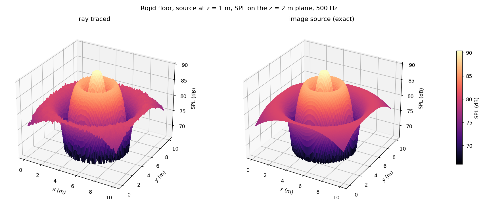
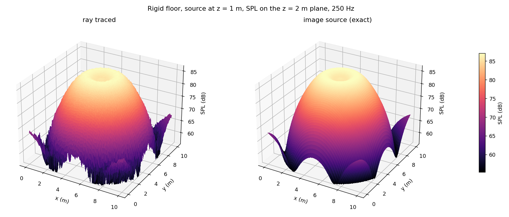
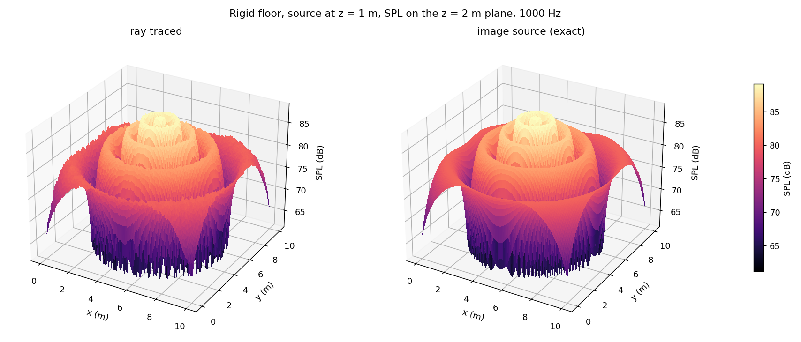

# Geometrical Acoustics: Ray Tracing Method

There are several methods for modelling a sound field. At higher frequencies, where the wavelength of sound is smaller than the objects it interacts with, ray tracing can simulate the acoustics of an enclosed space, provided the acoustic properties of the air and surfaces are known. The main challenge is computing the many reflection paths from source to receiver; an accurate simulation needs a lot of rays.

This project is a C++20 ray tracer for a shoe-box room. Each ray carries a **complex pressure**: its phase follows the image-source path length, and each wall can have a complex reflection coefficient. Because of this, the simulation reproduces **interference** between direct and reflected sound. The same core runs natively (multi-threaded CLI) and in the browser as **WebAssembly**.

**▶ Interactive web simulator** (`python scripts/serve.py`, then open http://localhost:8000): change the room, walls, source and frequency, and watch the SPL map converge in real time.



## Validation

The ray-traced SPL is checked against the exact **image-source** solution, which is the coherent sum over all image sources up to the traced reflection order. The test suite enforces these cases:

| Scenario | Set-up | Result |
|---|---|---|
| Anechoic | 4 m cube, all walls absorbing, receiver 2 m from source, 4M rays | error 0.06 dB |
| **Case I** | rigid floor, receiver moved *perpendicular* to the floor | RMS error 0.15 dB |
| **Case II** | rigid floor, receiver moved *parallel* to the floor | RMS error 0.39 dB |
| Reverberant | all 6 walls R = 0.6 + 0.3i, 3rd-order reflections | RMS error 0.43 dB |

### SPL over a horizontal plane: 250 Hz, 500 Hz, 1000 Hz

The room is 10 × 10 × 4 m with only the floor reflecting (R = 1) and the source 1 m above the floor. SPL is shown on the z = 2 m plane, from 20M rays and 100 × 100 receivers. Each figure puts the ray-traced result (left) next to the exact image-source solution (right). The interference rings get closer together as the frequency rises.

#### Sound source @ 250 Hz

#### Sound source @ 500 Hz

#### Sound source @ 1000 Hz


To regenerate a figure:

```bash
gart grid --rays 2e7 --freq 500 --radius 0.05 --step 0.1 --out grid_500Hz.csv
python tools/plot_results.py grid_500Hz.csv --compare --save docs/figures/spl3d_500Hz.png
```

The original v1 figures (1M rays, single-precision code) are kept in `docs/figures/Case2_1mil_*.png`.

## Repository layout

```
core/       header-mostly C++20 library (namespace gart): geometry, tracer, receivers, image-source reference
apps/cli/   `gart` command-line simulator (anechoic | case1 | case2 | grid scenarios, CSV output)
wasm/       Embind bindings -> web/wasm/gart.{js,wasm}
web/        static web app (vanilla ES modules + Three.js, Web Worker pool)
tests/      GoogleTest unit + physics validation tests, Node smoke test for the WASM build
tools/      plot_results.py (matplotlib plots of CLI output)
scripts/    build-native.sh, build-wasm.sh, serve.py
docs/       figures and the legacy program's reference CSVs
```

## Building

Requirements: CMake ≥ 3.20 and a C++20 compiler (GCC 11+, Clang 14+, MSVC 2022), or just Docker.

```bash
# Native CLI + tests (falls back to the emscripten/emsdk Docker image if no compiler is found)
scripts/build-native.sh

# WebAssembly module -> web/wasm/ (uses local emsdk or Docker)
scripts/build-wasm.sh

# Run the web simulator locally
python scripts/serve.py          # http://localhost:8000
```

Or with CMake directly:

```bash
cmake -S . -B build -DCMAKE_BUILD_TYPE=Release && cmake --build build -j && ctest --test-dir build
emcmake cmake -S . -B build-wasm && cmake --build build-wasm
```

Visual Studio 2022 opens the folder as a CMake project directly ("Open Folder").

### CLI

```bash
gart case2 --rays 3e6 --freq 500 --out case2_500Hz.csv
gart grid  --rays 5e6 --freq 1000 --slice-z 2 --step 0.05 --out map.csv
python tools/plot_results.py map.csv             # 3D SPL surface
python tools/plot_results.py map.csv --compare   # ray traced vs exact, side by side
python tools/plot_results.py case2_500Hz.csv     # SPL vs distance for a sweep
```

The plotting script needs `pip install numpy matplotlib`.

Run `gart` with no arguments for all options. By default each scenario uses the original program's parameters.

## How it works

1. Ray *i* gets a direction drawn uniformly on the sphere by hashing `(seed, i)`. Rays are never stored, any range of rays can be traced on its own, and the result is identical however the work is split across threads or Web Workers.
2. A ray is a straight line from its current **image source**. At each reflection the image source and direction are mirrored across the wall hit, and the ray's gain is multiplied by that wall's complex reflection coefficient R. In an axis-aligned box the wall hit is found in closed form.
3. Each segment is tested against **all receivers in one pass**. A receiver is a sphere of radius *a*. A ray whose line passes within *a* of the centre contributes
   `p = R_eff · P0 · e^{ikr}`, `P0 = 2r·sqrt(ρcWπD/V) / (N·L)`, where `V = 4/3·πa³` and `L = sqrt(π)·a`.
   Here *r* is the image-source distance and *D* the chord the ray cuts through the sphere.
4. The SPL is `20·log10(|Σp| / 20 µPa)`.

On a grid of receivers, each segment only tests the cells it passes near, so an SPL map costs about the same as a single receiver.

## Modernisation notes (v2)

The original Visual Studio 2019 projects (`Case I`, `Case II`, `Ray-Tracing Method`) held three copies of the same code. They were replaced by one library plus the CLI, and remain in git history. A review of the old code found these problems:

* **Bug: receiver volume.** `(4 / 3) * PI * r³` used integer division, so V was π r³ and every result came out **≈ +1.1 dB too high**. The legacy anechoic run shows +0.70 dB in `docs/data/legacy_anechoic_250Hz.csv`. Fixed and covered by a test.
* **Bug: invalid wall index.** `find_reflecting_box_plane` could return −1, which was then used as an array index (undefined behaviour). Wall hits are now computed in closed form and always exist.
* **Bug: memory errors.** `generate_source()` was called twice, leaking 5M rays. `delete_source()` did not null its pointer, so the unit tests freed the same memory twice.
* **Precision.** Positions, phases and pressure sums were `float`; millions of float additions lose accuracy. Everything is now `double` / `std::complex<double>`.
* **Performance:**
  * Rays are generated on the fly instead of stored (≈350 MB for 5M rays before).
  * All receivers are traced in one pass, where Case II used to re-trace every ray for each of its 99 positions.
  * Closed-form wall hits; no large objects copied by value in the hot loop.
  * Multi-threaded.

  The 5M-ray anechoic run went from 14.4 s (recorded in the legacy CSV) to 0.26 s on one thread and 0.045 s on 16 threads. Case II, 1M rays × 99 receivers, takes 0.37 s on one thread.
* **Code quality.** No `using namespace std` in headers, no globals, RAII throughout, `[[nodiscard]]`, warnings at `-Wall -Wextra -Wconversion` (clean), GoogleTest fetched by CMake.

## Web simulator

* Each Web Worker loads its own copy of the WASM module. Workers take ray ranges from a shared queue and send back partial complex sums, so the maps and the line plot update progressively and the run can be stopped at any time. It needs no `SharedArrayBuffer` or special headers, so it runs from any static host (GitHub Pages).
* Presets reproduce Case I, Case II and the anechoic run, plus a horizontal floor-reflection map, a reverberant 6th-order room and a 1 kHz floor/ceiling interference case.
* Views:
  * 3D room with wall opacity ∝ |R|, sampled ray paths and the SPL slice.
  * SPL map, as a flat 2D heat map or a rotatable 3D surface (height and colour = SPL): ray traced, image source, or the difference between them.
  * SPL along a receiver line compared with the exact solution.

### Optional: GitHub Actions CI

`docs/ci-workflow.yml` is a ready-made workflow. It builds and tests on Linux and Windows, builds and smoke-tests the WASM module, and deploys `web/` to GitHub Pages from `main`. It is not enabled. To enable it:

1. Copy it to `.github/workflows/ci.yml`. Pushing this needs a GitHub token with the `workflow` scope.
2. Set *Settings → Pages → Source* to "GitHub Actions".
